# 図書管理システム（Library Management System）

React + TypeScript + Supabase を基盤とした図書管理システムです。利用者画面、管理者画面、貸出・お気に入り・レビュー機能、Edge Function ベースの AI アシスタントを備えています。

## 画面プレビュー

以下の 15 枚は、2026-11-10 にローカルで動作する実際の画面から撮影したスクリーンショットです。一時データベースのデモアカウント、図書、オリジナルのデモ用表紙を使用しており、本番環境の利用者情報は表示していません。デスクトップの表示領域は 1440 × 1000、スマートフォンは 390 × 844 です。長いページは全体を、ダイアログは表示領域内を撮影しています。

### ログインと利用者ホーム

ログイン画面から新規登録とパスワード再設定に進めます。利用者ホームには、おすすめ、人気ランキング、新着図書、カテゴリ別の閲覧機能があります。

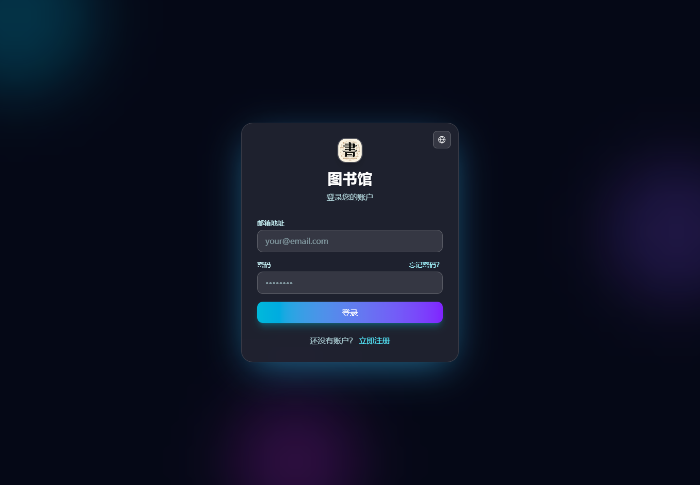

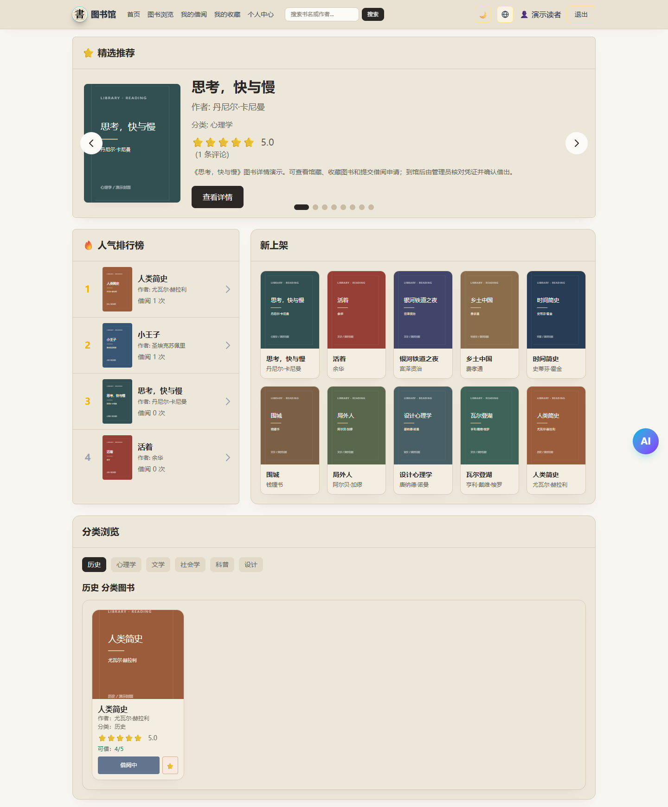

### 蔵書一覧と図書詳細

蔵書を閲覧し、書名や著者で検索できます。詳細画面では在庫、評価、レビューを確認し、お気に入りへの追加や貸出申請ができます。

| 蔵書一覧 | 図書詳細 |
| --- | --- |
| 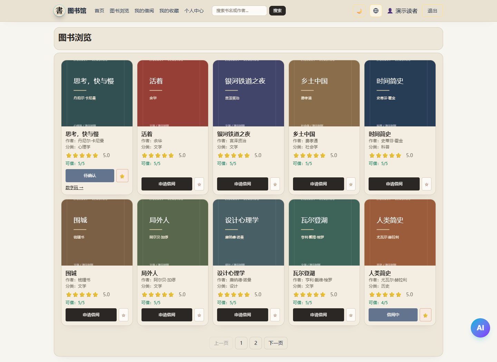 | 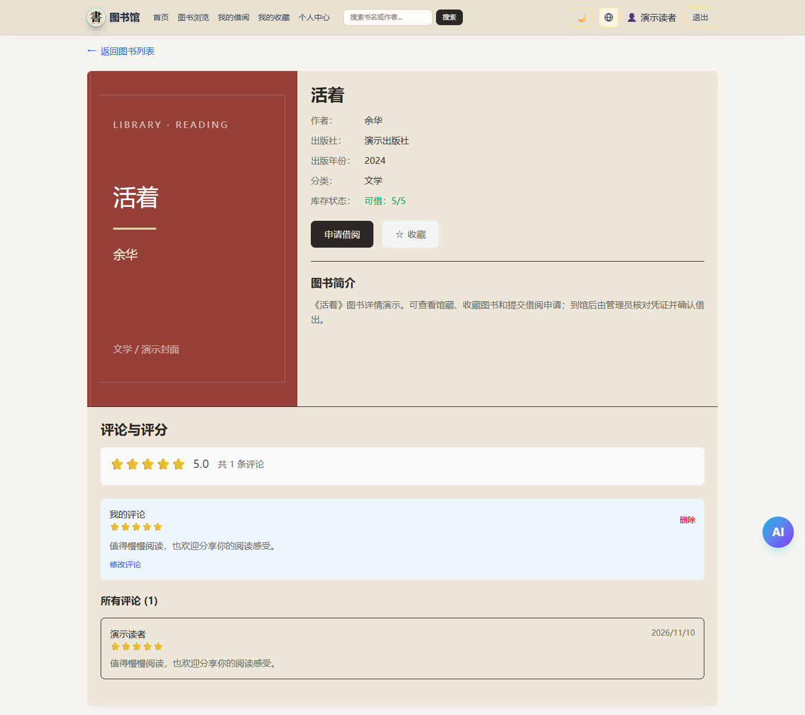 |

### 貸出申請の確認コードと貸出中の図書

申請すると、QR コード、バーコード、それらと同じ 8 桁の数字コードが発行されます。来館時に管理者が内容を照合して貸出を確定すると、その時点から貸出期間が始まります。返却も管理者が図書を受け取って確定します。

| 確認待ちの申請と確認コード | 貸出中の図書と返却期限 |
| --- | --- |
| 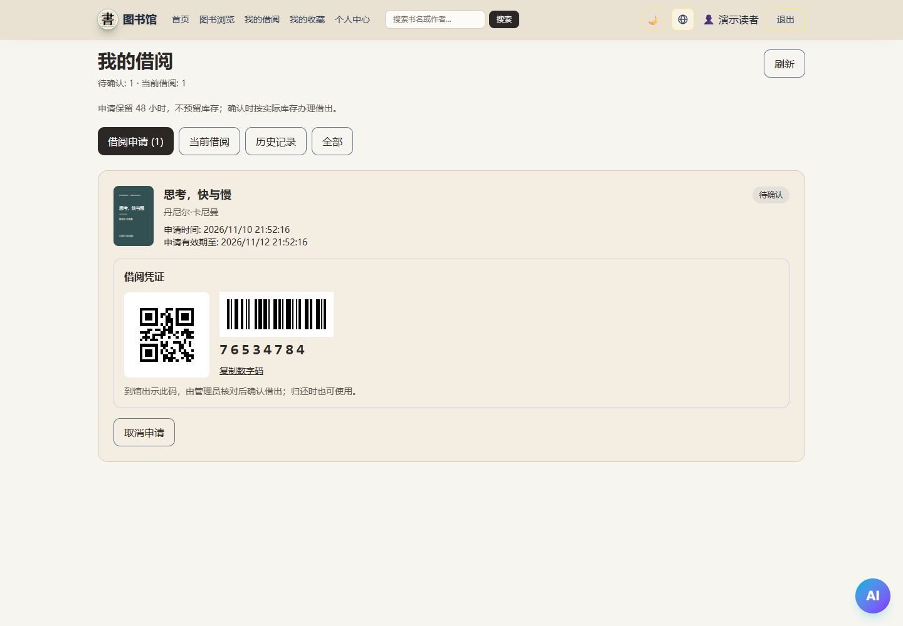 | 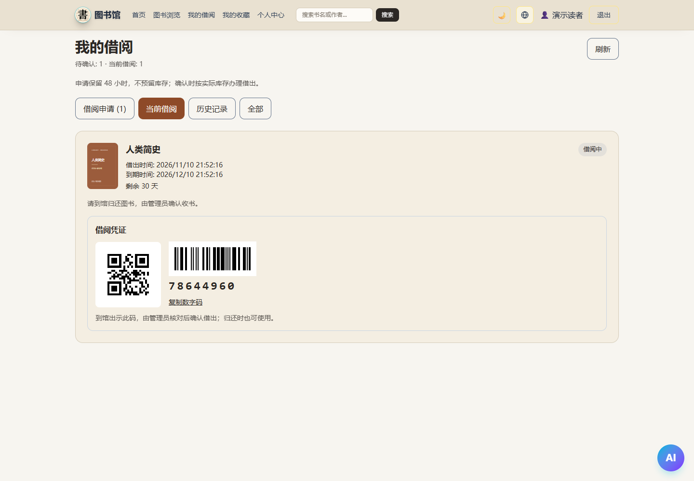 |

### お気に入りとプロフィール

| お気に入り | プロフィール |
| --- | --- |
| 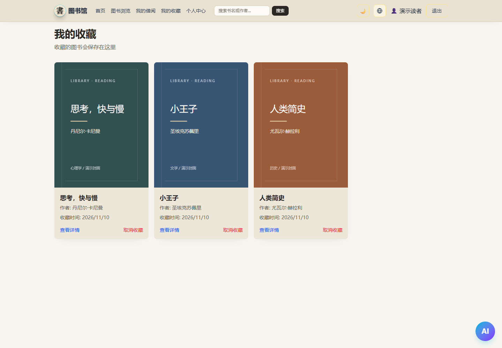 | 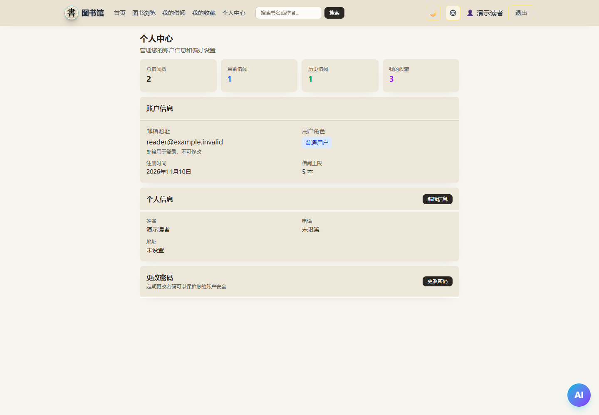 |

### 管理者画面

管理者は図書と表紙の管理、確認コードの検索、貸出の確定、申請の却下、返却の確定ができます。スキャン用入力欄の左側にはバーコードのアイコンがあり、未入力時は灰色の入力ガイドを表示します。カメラでの読み取りにも対応しています。

| 図書管理 | 図書の追加 |
| --- | --- |
| 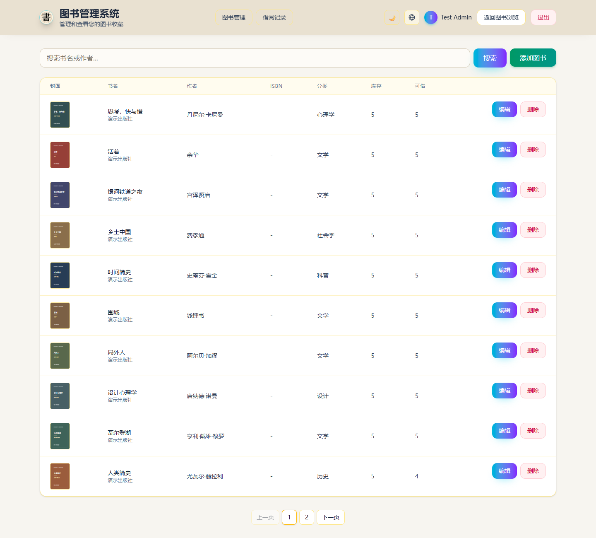 | 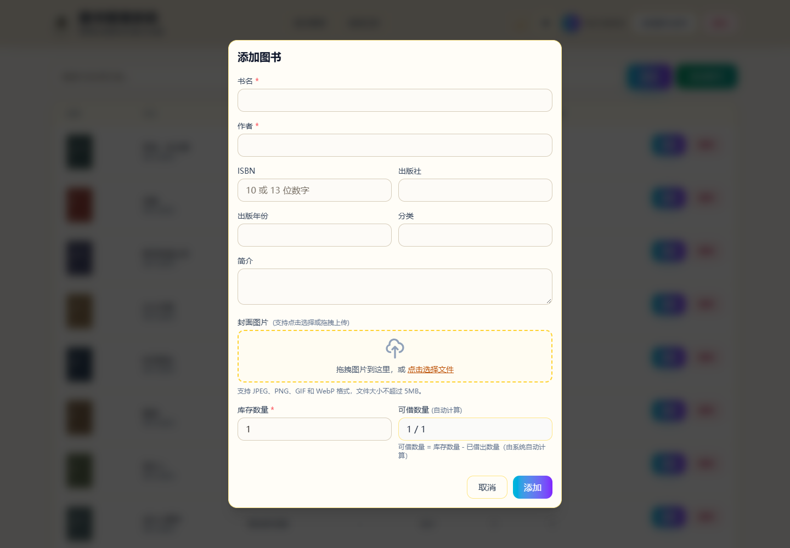 |
| 確認コードの検索画面 | 検索後の照合と貸出確定 |
| 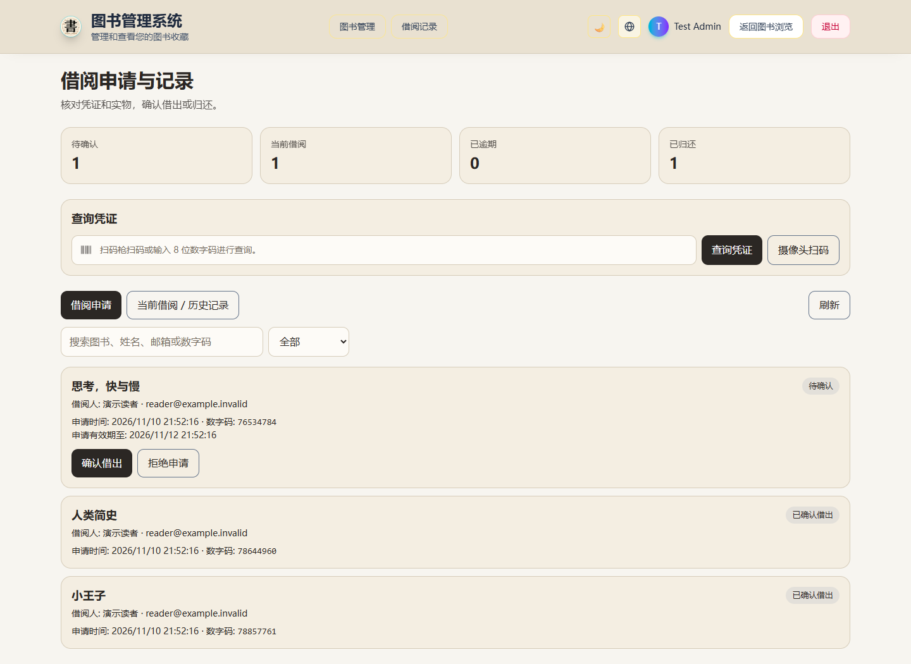 | 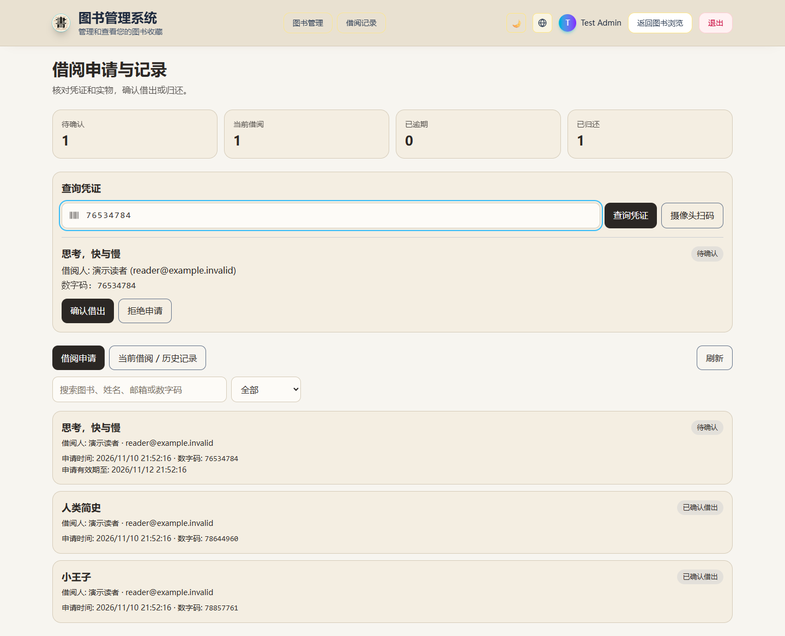 |

### スマートフォン表示・多言語・テーマ

スマートフォンのブラウザでは折りたたみ式のナビゲーションを利用でき、確認コードやスキャン用入力欄も狭い画面に合わせて配置されます。以下は Web 版のレスポンシブ表示です。Flutter 版のモバイルアプリは別プロジェクトで管理しています。

<p>
  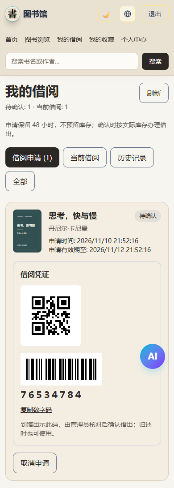
  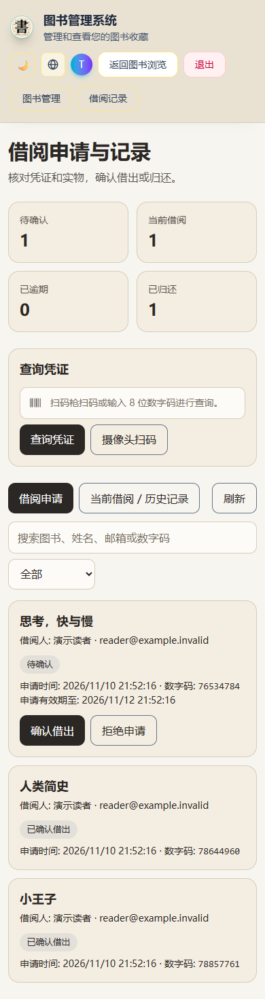
</p>

中文・English・日本語とライト・ダークテーマに対応しています。以下は日本語のダークテーマです。デモ図書の書名は原文のまま表示しています。

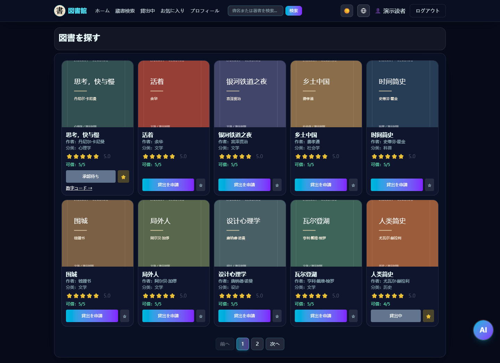

スクリーンショットは [docs/screenshots](docs/screenshots) に保存しています。再撮影の手順は、後述の「テストとスクリーンショットの再現」を参照してください。

## オンラインで試す


https://library-management-system-chi-lyart.vercel.app/

### テスト用管理者アカウント

メールアドレス：admin@gmail.com

パスワード：admin123

### テスト用一般利用者アカウント（新規登録も可能）

メールアドレス：user@gmail.com

パスワード：user123

## 技術スタック

- React 19 + TypeScript 5
- Vite 7 + Tailwind CSS 4
- React Router 7
- Supabase（Auth / PostgreSQL / Storage / Edge Functions）

## 実装済み機能

- 認証：ログイン、新規登録、パスワードを忘れた場合の手続き、パスワード再設定
- 利用者画面：ダッシュボード、蔵書一覧、図書詳細、自分の貸出状況、お気に入り、プロフィール
- 管理者画面：図書管理（CRUD）、貸出申請の審査、貸出と返却の確定
- 業務機能：貸出申請 → 確認コードの提示 → 管理者による貸出確定 → 管理者による返却確定。申請の取消・却下・期限切れ、お気に入り、レビュー評価、表紙のアップロードにも対応
- 多言語：中文 / English / 日本語の切り替え
- AI アシスタント：`ai-chat` Edge Function、フロントエンドの会話カード、図書のページング付き推薦

## ルーティング（現行実装）

- 未ログイン：ログイン・新規登録を同一ルート内で切り替えて表示。`/reset-password` には直接アクセス可能
- ログイン済み利用者：
  - `/user/dashboard`
  - `/user/home`、`/user/books`
  - `/user/books/:id`
  - `/user/my-borrowings`
  - `/user/my-favorites`
  - `/user/profile`
- 管理者専用：
  - `/admin/dashboard`
  - `/admin/borrowings`

## クイックスタート

1. 依存関係をインストール

```bash
npm install
```

2. 環境変数ファイルをコピー

```bash
cp .env.example .env
```

3. `.env` に以下を設定

```env
VITE_SUPABASE_URL=https://your-project.supabase.co
VITE_SUPABASE_ANON_KEY=your-anon-key
```

4. `部署指南.md` に従い、データベース・RLS・Storage を設定

5. 開発サーバーを起動

```bash
npm run dev
```

デフォルトのアクセス先：`http://localhost:5173`

## よく使うスクリプト

```bash
npm run dev
npm run build
npm run preview
npm run lint
```

## テストとスクリーンショットの再現

2026-11-10 に、現在の Web 版コードで以下の検証を実施しました。

| 検証項目 | 今回の結果 | 対象範囲 |
| --- | --- | --- |
| データベース回帰テスト | 7 / 7 成功 | 申請、審査、在庫の競合、重複操作、延滞図書の返却、利用者権限、履歴の保護 |
| ブラウザ回帰テスト | 16 / 16 成功 | ログイン・新規登録・パスワード再設定、画面のアクセス権限、図書の CRUD、検索、お気に入り、レビュー、プロフィール編集、貸出・返却の流れ、QR コード・バーコードの読み取り、模擬カメラ入力、スマートフォン表示、多言語とテーマ |
| ESLint | 成功 | プロジェクトのコード検査 |
| TypeScript + Vite | 成功 | 型検査と本番ビルド |
| ドキュメント用スクリーンショット | 15 枚 | 利用者画面、管理者画面、スマートフォン表示、日本語のダークテーマ |

ブラウザ回帰テストでは、実際の React 画面と Supabase クライアントを動かし、ネットワークリクエストを一時 PostgreSQL データベースに接続するよう差し替えています。ログイン、メール送信リクエスト、カメラ入力にはテスト用の代替処理を使用しています。今回の検証では実際のメール送信や本番環境の蔵書・利用者データの変更は行っておらず、実物のスキャナー、実機カメラ、AI クラウドサービスとの結合テストも再実施していません。本番ビルドは成功していますが、一部の圧縮後のバンドルが 500 kB を超えるという警告は残っています。

依存関係のインストールと前述の環境変数の設定を済ませた後、以下を実行できます。

```bash
npm run test:db
npm run test:ui
npm run lint
npm run build
```

ブラウザテストにはローカルの Chrome を使用します。テストツールが `http://127.0.0.1:5173` を自動で起動するか、すでに動作しているサーバーを再利用します。詳細な検証範囲は [画面と貸出フローの検証記録](TEST_REPORT_2026-11-10.md) を参照してください。

README 用のスクリーンショットを再撮影する場合は、まず一つのターミナルで Web アプリを起動します。

```bash
npm run dev -- --host 127.0.0.1 --port 5173
```

次に、別のターミナルでプロジェクトのルートから以下を実行します。

```bash
node scripts/capture-readme.mjs
```

スクリプトは同じ一時データベースとデモデータを使って各画面を実際に開き、`docs/screenshots/*.png` を上書きします。本番データベースへの書き込みは行いません。QR コードに含まれる数字コードと画面内の日時は、撮影のたびに変わります。

### Edge Function（AI アシスタント）関連のスクリプト

```bash
npm run supabase:functions:serve
npm run supabase:cloud:secrets
npm run supabase:functions:deploy
```

> 注意：`package.json` の `--project-ref` は、自分の Supabase プロジェクトに合わせてください。

## 環境変数一覧

| 変数 | 配置場所 | 用途 |
| --- | --- | --- |
| `VITE_SUPABASE_URL` | ルートの `.env` | フロントエンドの接続先 Supabase URL |
| `VITE_SUPABASE_ANON_KEY` | ルートの `.env` | フロントエンドの匿名 key（公開可） |
| `CHAT_PROVIDER` | `supabase/functions/.env` | `deepseek` または `ollama` |
| `DEEPSEEK_API_KEY` | `supabase/functions/.env` | DeepSeek のモデル API key（関数側のみ） |
| `OLLAMA_BASE_URL` | `supabase/functions/.env` | Ollama API URL |

## セキュリティ上の要点

- フロントエンドでは `anon` key のみを使用し、`service_role` は配置しないでください。
- モデルの API key は `supabase/functions/.env` とクラウドの secrets のみに保存してください。
- 権限制御は RLS + RPC を基準とし、フロントエンドのルートガードは操作性を補助するものとして扱います。

## 関連ドキュメント

- [デプロイガイド](./部署指南.md)
- [データベース文書](./DATABASE.md)
- [Supabase テーブルと SQL の設計案](./SUPABASE_TABLES_PROPOSAL.md)
- [プロジェクト設計書](./项目设计书.md)
- [利用者画面の設計](./USER_INTERFACE_DESIGN.md)
- [AI アシスタントの説明](./AI_ASSISTANT.md)
