# 图书管理系统（Library Management System）

一个基于 React + TypeScript + Supabase 的图书管理系统，包含用户端、管理员端、借阅收藏评论、以及 Edge Function AI 助手。

## 界面预览

以下 15 张截图于 2026-11-10 从本地运行的实际页面采集，使用临时数据库中的演示账号、图书和原创演示封面，不展示线上用户资料。桌面窗口为 1440 × 1000，手机布局为 390 × 844；长页面保留完整内容，弹窗按窗口截图。

### 登录与读者首页

登录页提供登录、注册和找回密码入口；读者首页展示精选推荐、人气排行榜、新上架和分类浏览。

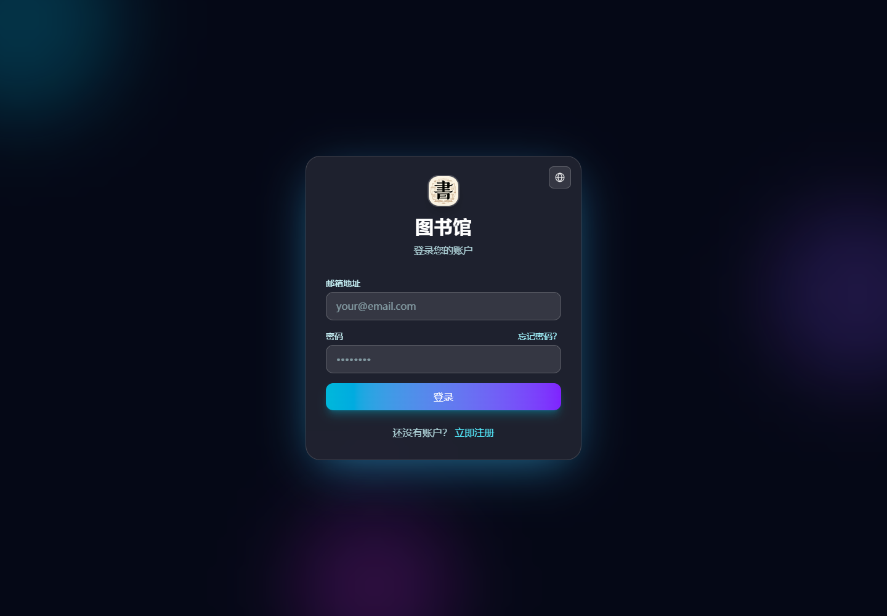

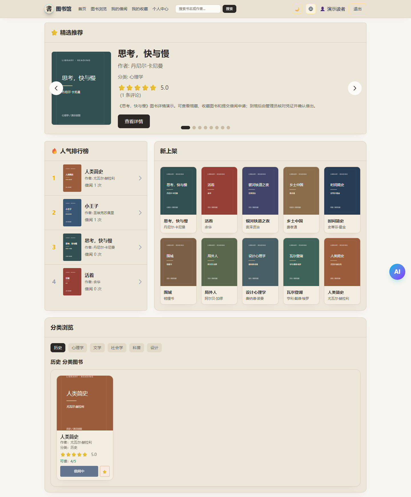

### 图书浏览与详情

浏览馆藏、搜索书名或作者，进入详情查看库存、评分和评论，再收藏图书或申请借阅。

| 图书浏览 | 图书详情 |
| --- | --- |
| 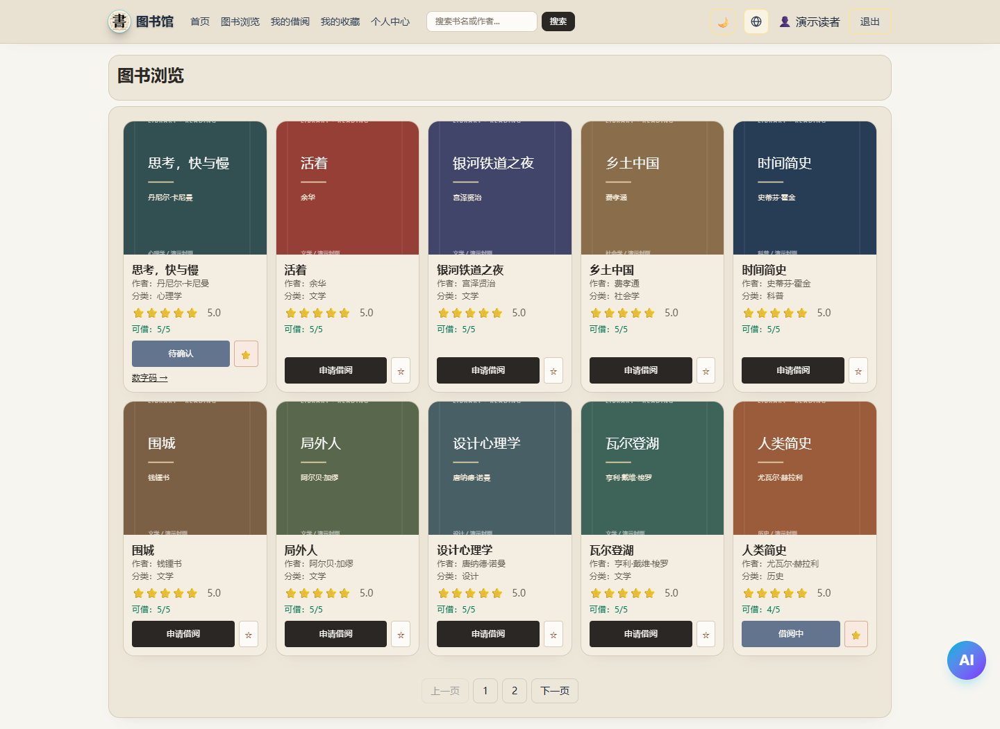 | 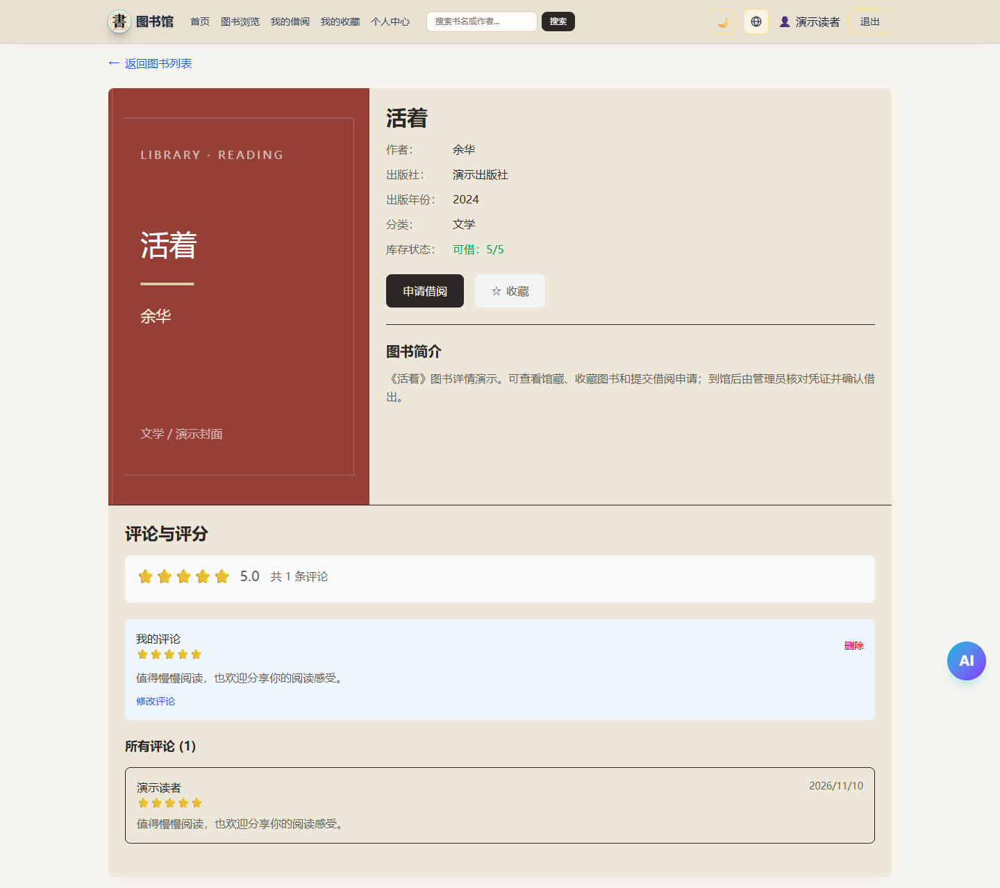 |

### 借阅凭证与当前借阅

读者申请后获取二维码、条形码和同一个 8 位数字码。管理员到馆核对后确认借出，借期从确认时开始；归还也由管理员确认收书。

| 待确认申请与借阅凭证 | 当前借阅与归还日期 |
| --- | --- |
| 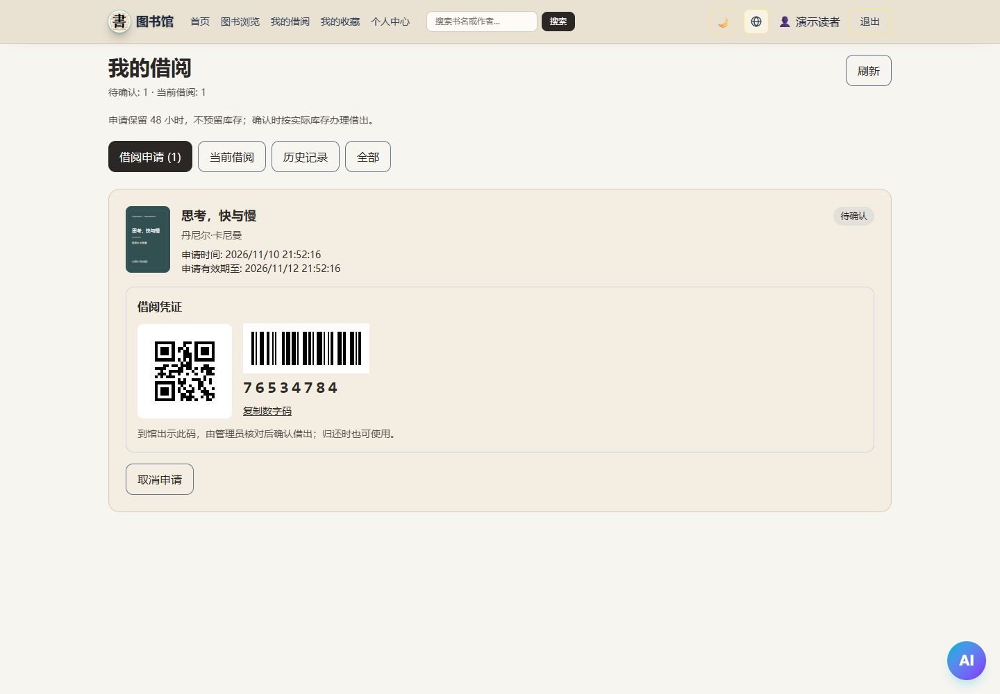 | 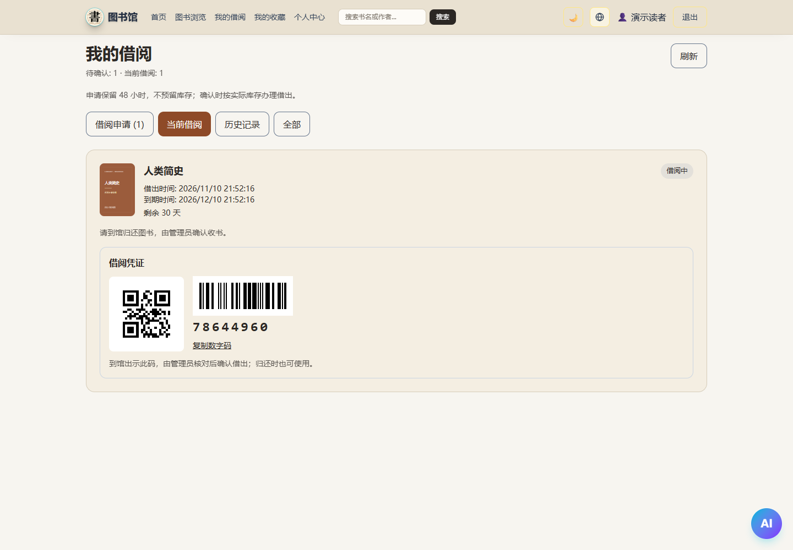 |

### 收藏与个人中心

| 我的收藏 | 个人中心 |
| --- | --- |
| 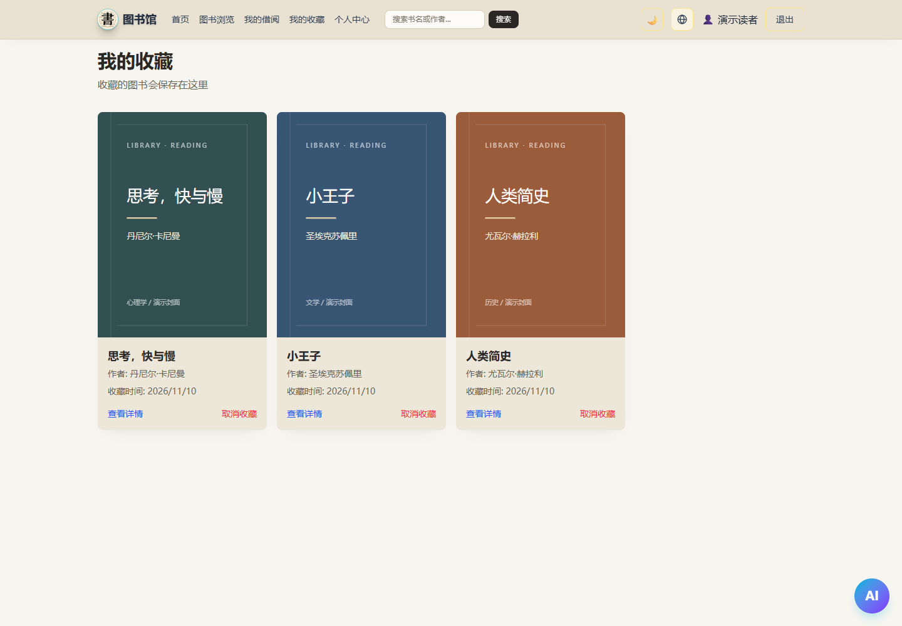 | 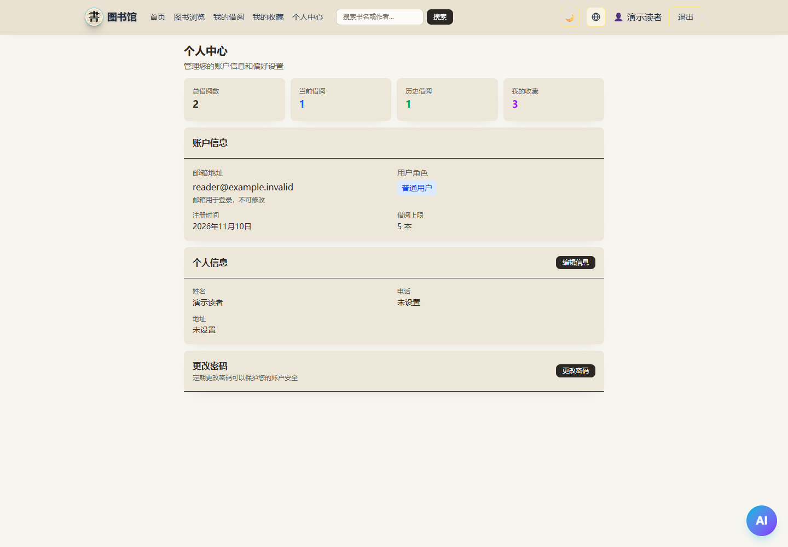 |

### 管理员后台

管理员维护图书和封面、查询凭证、确认借出、拒绝申请或确认归还。扫码输入框左侧提供条形码图标，空白时显示灰色输入提示，也可使用摄像头识别。

| 图书管理 | 添加图书 |
| --- | --- |
| 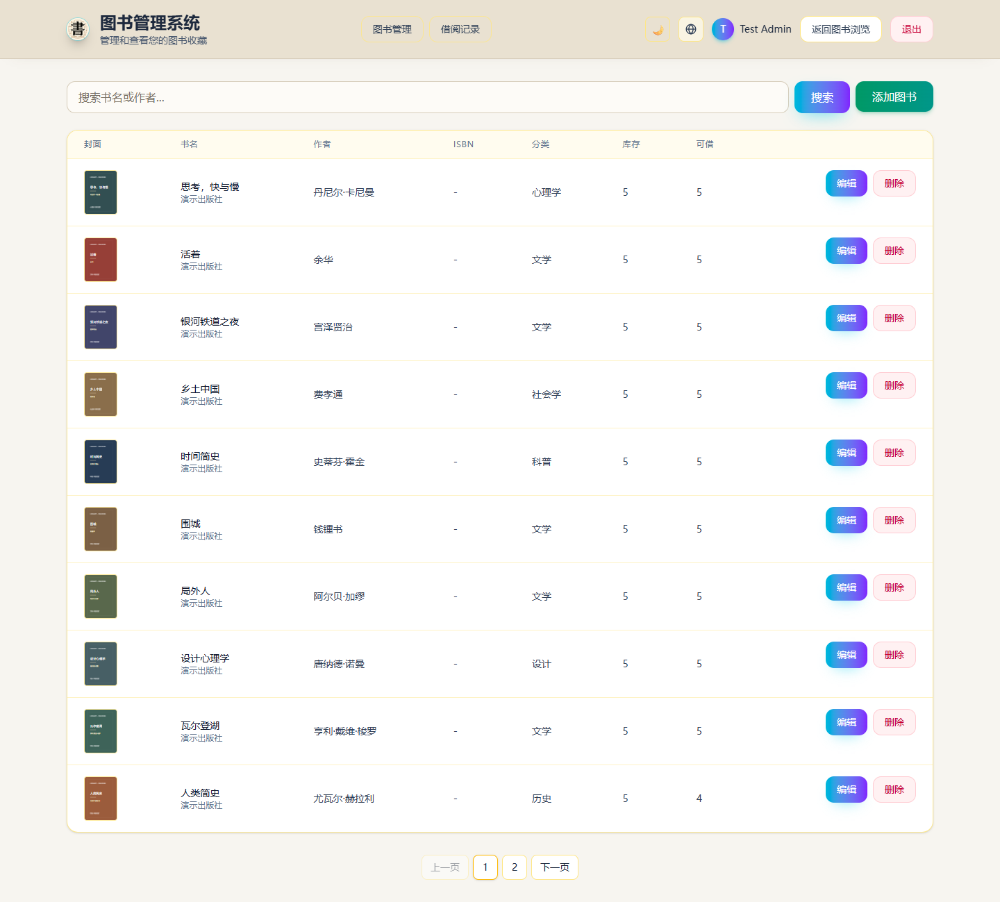 | 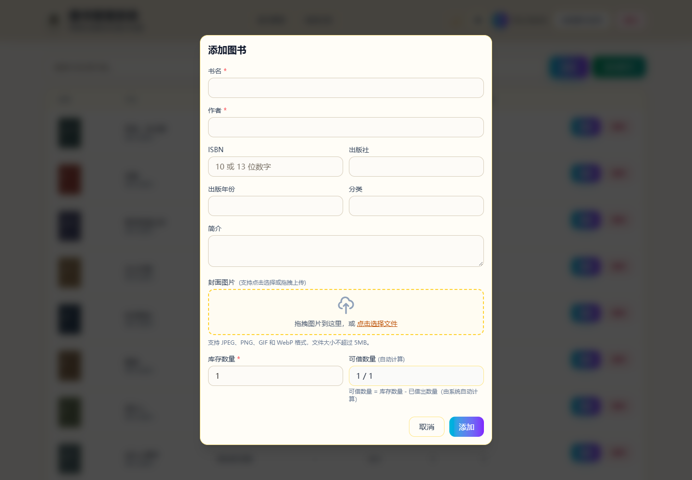 |
| 凭证查询入口 | 查询后核对并确认借出 |
| 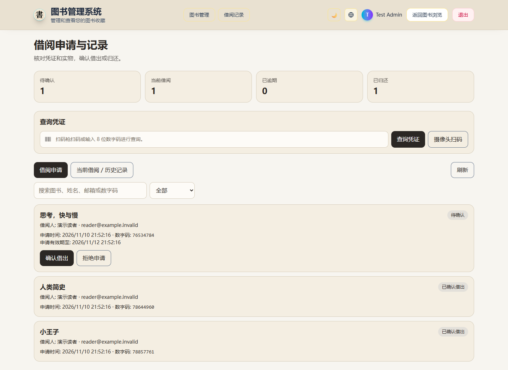 | 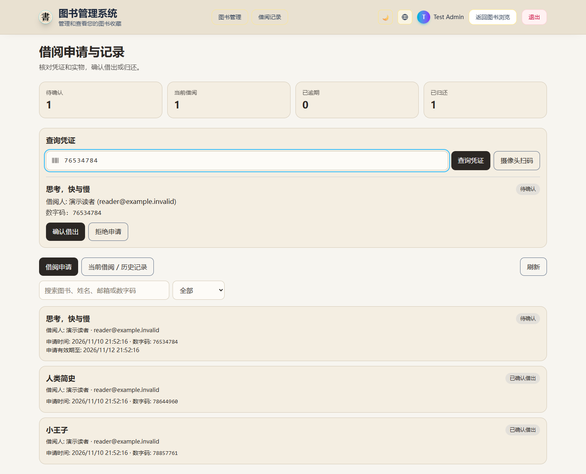 |

### 手机布局与多语言主题

手机浏览器提供折叠导航，凭证和扫码输入区域按窄屏排列。以下为网页响应式布局，Flutter 手机端维护在独立项目中。

<p>
  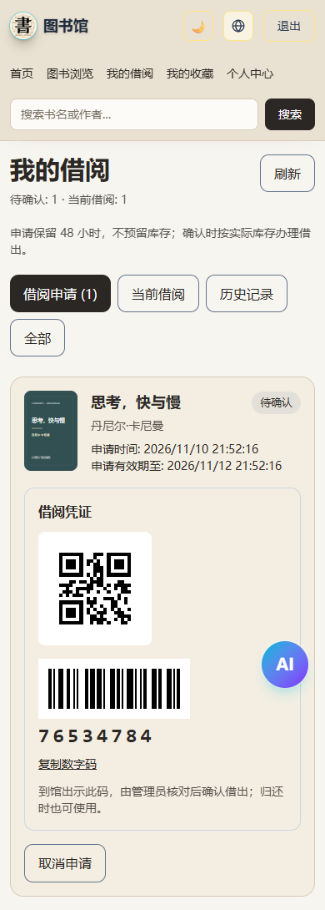
  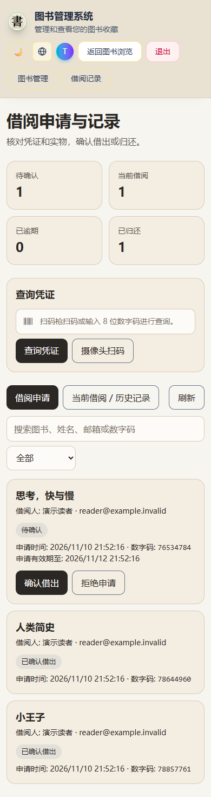
</p>

支持中文、English、日本語和深浅主题；下面展示日语深色界面，演示图书书名保留原文。

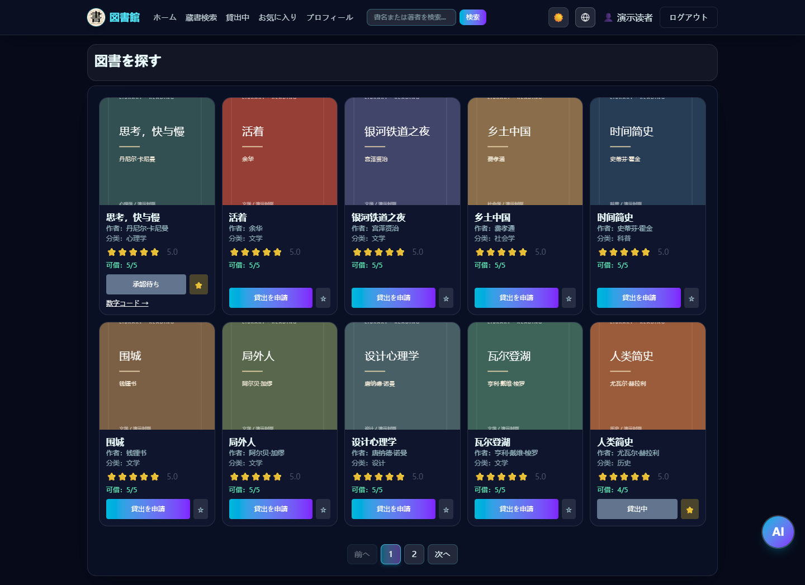

截图保存在 [docs/screenshots](docs/screenshots)，重新采集方法见下方“测试与截图复现”。

## 在线查看


https://library-management-system-chi-lyart.vercel.app/

### ===测试管理员账号===

账号：admin@gmail.com

密码：admin123

### ===测试用一般用户账号(也可以选择注册新账号)===

账号:user@gmail.com

密码:user123

## 技术栈

- React 19 + TypeScript 5
- Vite 7 + Tailwind CSS 4
- React Router 7
- Supabase（Auth / PostgreSQL / Storage / Edge Functions）

## 已实现能力

- 认证：登录、注册、忘记密码、重置密码
- 用户端：仪表盘、图书浏览、图书详情、我的借阅、我的收藏、个人资料
- 管理端：图书管理（CRUD）、借阅申请审核、借出与归还确认
- 业务：借阅申请 → 出示凭证 → 管理员确认借出 → 管理员确认归还；支持取消、拒绝和过期状态，以及收藏、评论评分、封面上传
- 多语言：中文/English/日本語切换
- AI 助手：`ai-chat` Edge Function + 前端对话卡片 + 书目分页推荐

## 路由（当前实现）

- 未登录：默认显示登录/注册（同一路由内切换），`/reset-password` 可直接访问
- 已登录用户：
  - `/user/dashboard`
  - `/user/home`、`/user/books`
  - `/user/books/:id`
  - `/user/my-borrowings`
  - `/user/my-favorites`
  - `/user/profile`
- 管理员专属：
  - `/admin/dashboard`
  - `/admin/borrowings`

## 快速开始

1. 安装依赖

```bash
npm install
```

2. 复制环境变量

```bash
cp .env.example .env
```

3. 在 `.env` 中填写：

```env
VITE_SUPABASE_URL=https://your-project.supabase.co
VITE_SUPABASE_ANON_KEY=your-anon-key
```

4. 按照 `部署指南.md` 完成数据库/RLS/Storage 配置。

5. 启动开发：

```bash
npm run dev
```

默认访问：`http://localhost:5173`

## 常用脚本

```bash
npm run dev
npm run build
npm run preview
npm run lint
```

## 测试与截图复现

2026-11-10 对当前网页代码重新执行了以下检查：

| 检查 | 本次结果 | 覆盖内容 |
| --- | --- | --- |
| 数据库回归 | 7 / 7 通过 | 申请、审核、库存竞争、重复操作、逾期归还、读者权限及历史保护 |
| 浏览器回归 | 16 / 16 通过 | 登录/注册/找回密码、页面权限、图书增删改查、搜索、收藏、评论、资料修改、借还流程、二维码/条形码解码、摄像头模拟识别、手机布局及多语言主题 |
| ESLint | 通过 | 项目代码检查 |
| TypeScript + Vite | 通过 | 类型检查和生产构建 |
| 说明文档截图 | 15 张 | 读者端、管理端、手机布局、日语深色主题 |

浏览器回归运行真实 React 页面和 Supabase 客户端，通过拦截网络请求连接临时 PostgreSQL 数据库。登录、邮件请求和摄像头输入使用测试替身；本次没有发送真实邮件、修改线上馆藏或用户数据，也没有重新进行实体扫码枪、真实摄像头和 AI 云服务联测。生产构建仍提示部分压缩包超过 500 kB，构建成功。

安装依赖并完成前文的环境变量配置后，可运行：

```bash
npm run test:db
npm run test:ui
npm run lint
npm run build
```

浏览器测试使用本机 Chrome，测试工具会自动启动或复用 `http://127.0.0.1:5173`。更详细的验证范围见 [页面与借阅流程检查](TEST_REPORT_2026-11-10.md)。

重新采集 README 截图时，在一个终端启动网页：

```bash
npm run dev -- --host 127.0.0.1 --port 5173
```

然后在另一个终端从项目根目录执行：

```bash
node scripts/capture-readme.mjs
```

脚本使用同一套临时数据库和演示数据，实际打开各页面并覆盖 `docs/screenshots/*.png`；不会向线上数据库写入数据。二维码中的数字码和页面时间会随每次采集变化。

### Edge Function（AI 助手）脚本

```bash
npm run supabase:functions:serve
npm run supabase:cloud:secrets
npm run supabase:functions:deploy
```

> 注意：`package.json` 中 `--project-ref` 需与你自己的 Supabase 项目一致。

## 环境变量说明

| 变量 | 位置 | 用途 |
|---|---|---|
| `VITE_SUPABASE_URL` | 根目录 `.env` | 前端连接 Supabase 项目地址 |
| `VITE_SUPABASE_ANON_KEY` | 根目录 `.env` | 前端匿名 key（可公开） |
| `CHAT_PROVIDER` | `supabase/functions/.env` | `deepseek` 或 `ollama` |
| `DEEPSEEK_API_KEY` | `supabase/functions/.env` | DeepSeek 模型密钥（仅函数端） |
| `OLLAMA_BASE_URL` | `supabase/functions/.env` | Ollama API 地址 |

## 安全要点

- 前端只允许使用 `anon` key，不可放 `service_role`。
- 模型 API key 只放在 `supabase/functions/.env` 和云端 secrets。
- 权限控制以 RLS + RPC 为准，前端路由守卫只是体验层。

## 相关文档

- [部署指南](./部署指南.md)
- [数据库文档](./DATABASE.md)
- [Supabase 表与 SQL 方案](./SUPABASE_TABLES_PROPOSAL.md)
- [项目设计书](./项目设计书.md)
- [用户界面设计](./USER_INTERFACE_DESIGN.md)
- [AI 助手说明](./AI_ASSISTANT.md)
